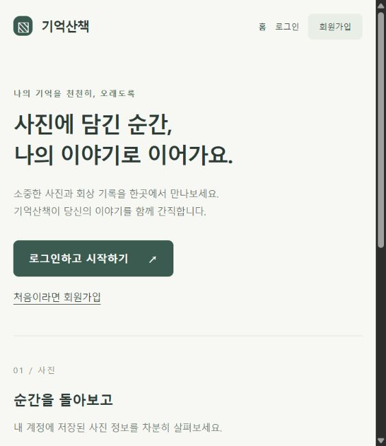
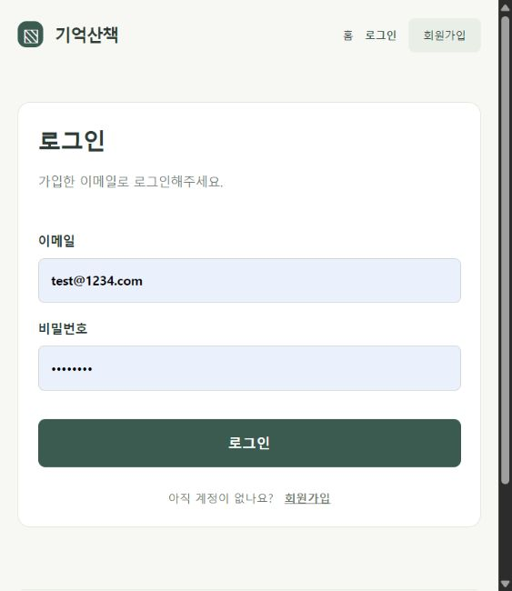

<div align="center">

# 기억산책

### 사진 속 순간을, 나의 이야기로

개인 사진으로 질문을 만들고, 답변과 훈련 기록을 차곡차곡 쌓아가는 기억 회상 서비스

**[서비스 체험하기](https://graduation-project-1-08z0.onrender.com/#/login)** · **[화면 미리보기](#화면-미리보기)** · **[실행 방법](#빠른-시작--windows-로컬-체험)** · **[문서](docs/README.md)**

`React 19` · `Spring Boot 3.5` · `MySQL` · `Gemini`

</div>

---

## 서비스 체험

[배포 사이트에서 시작하기 →](https://graduation-project-1-08z0.onrender.com/#/login)

| 테스트 계정 | 입력값 |
| --- | --- |
| 이메일 | `test@1234.com` |
| 비밀번호 | `12345678` |

## 화면 미리보기

배포 사이트에서 직접 캡처한 화면입니다. (2026-10-25)

<table>
<tr>
<th width="50%">01 · 시작 화면</th>
<th width="50%">02 · 로그인</th>
</tr>
<tr>
<td></td>
<td></td>
</tr>
<tr>
<td align="center">서비스 소개와 시작 안내</td>
<td align="center">테스트 계정으로 서비스 체험</td>
</tr>
</table>

## 사용 흐름

**로그인 → 사진·앨범 선택 → 질문 생성 → 회상 훈련 → 결과·이력 확인**

사진과 촬영 정보에서 회상 단서를 찾고, 질문과 답변을 훈련 이력으로 남깁니다. 다시 풀기는 새 훈련을 만들어 이전 기록과 함께 확인할 수 있습니다.

## 주요 기능

- 회원가입·로그인·JWT 인증 및 로그아웃
- 앨범과 사진 관리, 사진 메타데이터 활용
- Gemini를 이용한 사진 분석과 질문 생성
- 회상 답변·객관식 답안 제출, 결과 저장과 재훈련
- 마이페이지에서 훈련 이력과 결과 조회

## 기술 구성

| 영역 | 기술 |
| --- | --- |
| 프론트엔드 | React 19, Vite 6 |
| 백엔드 | Java 17, Spring Boot 3.5, Spring Security, JPA |
| 데이터 | MySQL, Flyway / 로컬 체험용 H2 |
| 사진·AI | metadata-extractor, Gemini, Cloudflare R2 |
| 테스트 | Spring Boot Test, Playwright |

버전과 의존성은 [백엔드 빌드 설정](backend/build.gradle)과 [프론트엔드 패키지 설정](frontend/package.json)을 기준으로 합니다.

## 저장소 구성

```text
graduation_project/
├── backend/      # 실제 서비스 API, 인증, AI 연동, DB 마이그레이션
├── frontend/     # React 화면과 브라우저 테스트
├── ai/           # AI 구현 위치, 프롬프트·평가 자료 안내
├── assets/       # 소개 이미지, 화면 캡처, 다이어그램
├── database/     # DB 설계와 마이그레이션 안내
├── demo/         # 로컬 체험 방법과 시연 순서
├── docs/         # 문서 목차와 분야별 자료 안내
├── src/          # 기존 루트 Spring 프로젝트
├── Start-Local.ps1
├── Stop-Local.ps1
└── README.md
```

현재 서비스 실행 기준은 `backend/`와 `frontend/`입니다. 루트의 `src/`, `build.gradle.kts`, Gradle Wrapper는 기존 별도 Spring 프로젝트이며, 서비스 백엔드 명령은 `backend/`에서 실행합니다.

## 빠른 시작 — Windows 로컬 체험

JDK 17, Node.js 20.9 이상, Git이 필요합니다. 최초 실행에는 Gradle/npm 의존성 다운로드가 필요합니다.

```powershell
git clone https://github.com/jiwoo0611/graduation_project.git
cd graduation_project
.\Start-Local.ps1
```

- 화면: http://localhost:5173/#/login
- API: http://127.0.0.1:18080
- 로컬 자동 생성 계정: `demo@example.com` / `DemoPass123!` (위 배포 사이트 테스트 계정과 별개)
- 종료: `.\Stop-Local.ps1`
- 소스 변경 없이 다시 실행: `.\Start-Local.ps1 -SkipBuild`

로컬 체험은 H2 파일 DB와 예제 사진·질문을 사용합니다. 저장 데이터는 `backend/local-data/`, 사진은 `backend/uploads/`, 실행 로그는 `local-logs/`에 생성됩니다. 로컬 프로필의 공개 JWT 키와 체험 계정은 배포용으로 사용하지 않습니다.

실제 사진 AI 분석과 새 질문 생성에는 Gemini 등 외부 서비스 설정이 추가로 필요합니다. MySQL·R2 환경변수는 [백엔드 환경변수 예시](backend/.env.example)를 참고하세요. Spring Boot는 이 파일을 자동으로 읽지 않으므로 환경변수를 터미널 또는 실행 환경에 설정해야 합니다.

## 빌드와 테스트

백엔드 — 저장소 루트에서:

```powershell
cd backend
.\gradlew.bat clean build
```

프론트엔드 — 별도 터미널에서:

```powershell
cd frontend
npm ci
npm run build
```

브라우저 테스트별 실행 조건은 [프론트엔드 문서](frontend/README.md)와 해당 `playwright*.config.js`를 확인하세요. 기존 문서에 적힌 테스트 건수는 당시 검증 기록입니다.

## 문서

| 내용 | 위치 |
| --- | --- |
| 전체 문서 목차 | [docs](docs/README.md) |
| 백엔드 설정·API | [backend](backend/README.md) |
| 프론트엔드 실행·인증 | [frontend](frontend/README.md) |
| AI 구현·평가 자료 | [ai](ai/README.md) |
| DB 설계·마이그레이션 | [database](database/README.md) |
| 체험·시연 | [demo](demo/README.md) |
| 이미지·발표 자료 | [assets](assets/README.md) |

공통 소개와 문서는 분야별 폴더에서 관리하고, 실행 코드와 Flyway SQL은 각 애플리케이션 안에서 관리합니다.
