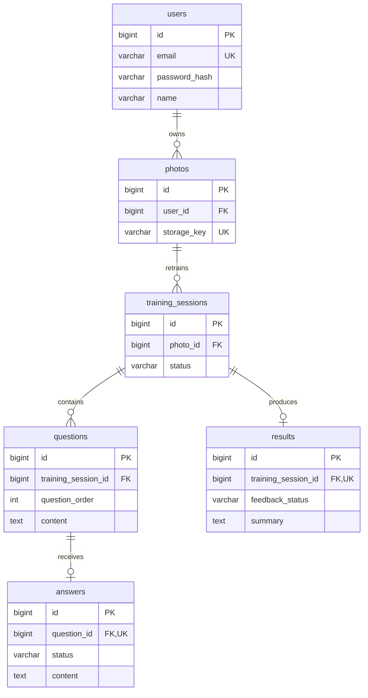

# DB 기본 설계 및 팀원 연동 규칙

실제 스키마의 기준은 `src/main/resources/db/migration/V1__create_core_tables.sql`입니다.
MySQL의 PK/UNIQUE/FK/CHECK로 무결성을 지키고, JPA는 `ddl-auto: validate`로 구조를 확인합니다.
적용된 V1을 바꾸지 말고 이후 변경은 V2, V3 마이그레이션으로 추가하세요.

## 관계와 ERD

User 1:N Photo, Photo 1:N TrainingSession, TrainingSession 1:N Question,
Question 1:0..1 Answer, TrainingSession 1:0..1 Result입니다.
답변이 없으면 미응답이며, 답변 레코드가 있으면 본문 제출 또는 명시적인 선택 상태입니다.
새 훈련마다 새로운 세션과 질문을 저장하므로 과거 질문/근거/답변/결과를 덮어쓰지 않습니다.
질문의 근거와 비교 기준은 당시 스냅샷으로 보존합니다.

소유자 경로: `Answer → Question → TrainingSession → Photo → User`,
`Result → TrainingSession → Photo → User`입니다.
Answer의 세션 ID는 Question FK를 통해 하나로 확정되므로 중복 컬럼을 두지 않았습니다.
세션에도 별도 user_id를 중복 저장하지 않아 사진 소유자와 세션 소유자가 엇갈리지 않습니다.
현재 소유권 이전 기능은 없습니다. 추후 사진 소유자를 바꾸는 기능을 만들면 모든 과거 기록에 영향을 주므로 별도 설계가 필요합니다.

## 공통 컬럼

아래 공통 컬럼은 6개 테이블 모두 포함합니다. BaseEntity에서 상속합니다.

| 컬럼 | 타입 | 제약/의미 |
|---|---|---|
| id | BIGINT | PK, AUTO_INCREMENT, NOT NULL |
| created_at | TIMESTAMP(6) | NOT NULL, 최초 저장 시각 |
| updated_at | TIMESTAMP(6) | NOT NULL, 마지막 변경 시각 |

시간은 애플리케이션에서 Instant/UTC로 저장합니다. 사진 메타데이터는 시간대가 없을 수 있어 DATETIME으로 별도 저장합니다.
created_at/updated_at은 JPA lifecycle로 입력되므로 직접 SQL INSERT를 하면 시간도 명시해야 합니다.

## users

| 컬럼 | 타입 | NULL | 제약/의미 |
|---|---|---|---|
| email | VARCHAR(254) | 불가 | UNIQUE, 로그인 ID; 공백 제거/소문자 정규화 |
| password_hash | VARCHAR(60) | 불가 | BCrypt 해시만 저장 |
| name | VARCHAR(100) | 불가 | 이름 |

`uk_users_email`은 중복 방지와 이메일 조회 인덱스 역할을 함께 합니다.
DB 내부 ID와 이메일 로그인 ID를 구분합니다. 별도 사용자 입력 아이디 컬럼은 없습니다.
DB를 직접 수정하는 경우에도 이메일 정규화 규칙을 따라야 합니다.

## photos

| 컬럼 | 타입 | NULL | 제약/의미 |
|---|---|---|---|
| user_id | BIGINT | 불가 | FK → users.id |
| storage_key | VARCHAR(500) | 불가 | UNIQUE, 비공개 저장소 식별자 |
| original_filename | VARCHAR(255) | 불가 | 업로드 당시 파일명 |
| content_type | VARCHAR(100) | 불가 | 검증한 파일 MIME 타입 |
| size_bytes | BIGINT | 불가 | CHECK > 0 |
| metadata_taken_at | DATETIME(6) | 허용 | 원본 메타데이터 촬영 시각 |
| metadata_location | VARCHAR(500) | 허용 | 원본 메타데이터 위치 |
| confirmed_taken_on | DATE | 허용 | 사용자가 확인한 날짜 |
| confirmed_location | VARCHAR(500) | 허용 | 사용자가 확인한 장소 |
| ai_clues | TEXT | 허용 | AI 추정 정보, JSON 텍스트를 담을 수 있음 |

인덱스: `idx_photos_owner_created(user_id, created_at)`, `uk_photos_storage_key(storage_key)`.
사진 바이너리는 DB에 넣지 않습니다. 사진 업로드와 파일 저장/조회 기능은 아직 구현하지 않았습니다.
storage_key는 외부에 그대로 공개할 다운로드 URL이 아닙니다. 서버에서 소유자 확인 후 파일을 제공해야 합니다.
원본 정보/확인 정보/AI 추정을 분리했으며, 모르는 날짜·장소는 NULL로 둘 수 있습니다.

## training_sessions

| 컬럼 | 타입 | NULL | 제약/의미 |
|---|---|---|---|
| photo_id | BIGINT | 불가 | FK → photos.id; UNIQUE 아님, 같은 사진 재훈련 허용 |
| status | VARCHAR(40) | 불가 | CHECK: CREATED / GENERATING_QUESTIONS / IN_PROGRESS / COMPLETED / QUESTION_GENERATION_FAILED |
| started_at | TIMESTAMP(6) | 불가 | 시작 시각 |
| completed_at | TIMESTAMP(6) | 허용 | 완료 상태에서 필수, 시작 시각 이후 |
| version | BIGINT | 불가 | JPA 낙관적 잠금용 버전, 기본 0 |

인덱스: `idx_sessions_photo_created(photo_id, created_at)`.
version은 동시에 같은 세션을 변경할 때 이전 상태를 덮어쓰지 않도록 충돌을 감지하는 값입니다.
세션 생성/완료 로직과 요청 재시도용 idempotency key 정책은 후속 API 구현에서 추가해야 합니다.

## questions

| 컬럼 | 타입 | NULL | 제약/의미 |
|---|---|---|---|
| training_session_id | BIGINT | 불가 | FK → training_sessions.id |
| question_order | INT | 불가 | CHECK > 0, 세션 내 순서 |
| content | TEXT | 불가 | 질문 원문 |
| type | VARCHAR(30) | 불가 | CHECK: PHOTO_CLUE / EXPERIENCE / CONTEXT / INFORMATION_CHECK |
| evidence_snapshot | TEXT | 불가 | 사용한 단서 및 출처의 생성 당시 스냅샷 |
| verifiable | BOOLEAN | 불가 | 확인된 비교 기준으로 검증할 수 있는지 |
| reference_information | TEXT | 허용 | verifiable=true이면 NOT NULL CHECK |
| generation_version | VARCHAR(100) | 불가 | 모델/프롬프트 생성 버전 |

`uk_questions_session_order(training_session_id, question_order)`는 중복 순서를 막고 세션별 질문 조회에도 사용됩니다.
근거의 제안 형식: `[{"source":"USER_CONFIRMED","clue":"사용자가 확인한 장소"}]`.
source는 METADATA / USER_CONFIRMED / AI_INFERENCE 등으로 팀 합의가 필요합니다.
현재는 JSON 스키마나 질문 생성의 품질을 검사하지 않습니다. TEXT를 쓰므로 문자열 구조 검증은 후속 service의 책임입니다.
DB는 질문 개수 3개를 강제하지 않습니다. 개인 경험·감정에 대한 점수 컬럼은 없습니다.

## answers

| 컬럼 | 타입 | NULL | 제약/의미 |
|---|---|---|---|
| question_id | BIGINT | 불가 | FK → questions.id, UNIQUE |
| status | VARCHAR(30) | 불가 | CHECK: ANSWERED / CANNOT_RECALL / QUESTION_MISMATCH |
| content | TEXT | 허용 | ANSWERED면 공백만 있는 본문 금지, 나머지 상태면 NULL |

`uk_answers_question(question_id)`로 질문당 답변은 최대 하나입니다.
중복 제출을 성공 응답으로 돌릴지 충돌로 돌릴지는 후속 service에서 정해야 합니다. 현재는 중복 레코드만 DB가 차단합니다.
세션 식별은 `answers.question_id → questions.training_session_id`로 합니다.
의도적인 건너뛰기는 CANNOT_RECALL, 질문 부적합은 QUESTION_MISMATCH, 미응답은 레코드 없음으로 구분합니다.

## results

| 컬럼 | 타입 | NULL | 제약/의미 |
|---|---|---|---|
| training_session_id | BIGINT | 불가 | FK → training_sessions.id, UNIQUE |
| feedback_status | VARCHAR(30) | 불가 | CHECK: PENDING / PROCESSING / COMPLETED / FAILED |
| summary | TEXT | 허용 | 실제 답변에 근거한 회상 요약 |
| answered_count | INT | 불가 | 텍스트 응답 수, 기본 0, CHECK >= 0 |
| cannot_recall_count | INT | 불가 | 기억나지 않음 선택 수, 기본 0, CHECK >= 0 |
| mismatch_count | INT | 불가 | 질문 부적합 선택 수, 기본 0, CHECK >= 0 |
| generation_version | VARCHAR(100) | 허용 | 피드백 생성 버전 |
| version | BIGINT | 불가 | 낙관적 잠금, 기본 0 |

`uk_results_session(training_session_id)`로 세션당 결과는 최대 하나입니다.
답변 저장 상태와 피드백 생성 상태를 분리했습니다. 결과가 아직 없거나 실패해도 답변은 별도 테이블에 남습니다.
응답 수 집계 및 요약 생성은 후속 기능이며, 현재는 초기값만 존재합니다. 의료/기억력 점수는 저장하지 않습니다.

## 삭제와 접근 제어

FK 삭제는 기본 RESTRICT/NO ACTION이며 JPA cascade REMOVE와 orphanRemoval을 사용하지 않습니다.
사진 삭제 때문에 과거 훈련 기록이 연쇄 삭제되는 일을 막습니다. 회원 탈퇴/사진 삭제 정책은 팀 합의 전까지 미구현입니다.
회원·사진·훈련의 양방향 컬렉션을 두지 않고 LAZY 단방향 관계로 시작해 불필요한 로딩과 JSON 순환을 피했습니다.
API는 Entity를 직접 반환하지 않고 DTO를 반환해야 합니다.

소유자 검사가 포함된 Repository 사용 예:

- 사진: `findByIdAndUser_Id(photoId, currentUserId)`
- 세션: `findByIdAndPhoto_User_Id(sessionId, currentUserId)`
- 질문: `findByIdAndTrainingSession_IdAndTrainingSession_Photo_User_Id(questionId, sessionId, currentUserId)`
- 답변: `findAllByQuestion_TrainingSession_IdAndQuestion_TrainingSession_Photo_User_Id(sessionId, currentUserId)`
- 결과: `findByTrainingSession_IdAndTrainingSession_Photo_User_Id(sessionId, currentUserId)`

중요: Repository 자체가 DB 행 수준 권한 시스템은 아닙니다. 기본 `findById`/`findAll`도 존재하므로
향후 사용자용 API는 반드시 토큰에서 구한 currentUserId로 소유자 조건 조회를 해야 합니다.
다른 사용자의 데이터를 요청하면 조회 결과가 없도록 설계했으며 후속 API에서는 404 처리로 존재 여부도 숨기는 것을 권장합니다.
쓰기 전에도 상위 객체의 소유권을 조회하고, 클라이언트가 보낸 userId나 임의 FK를 그대로 저장하지 마세요.

훈련 관련 Entity에는 아직 상태 전이/평가/생성 서비스가 없습니다. 후속 담당자가 트랜잭션 내 변경 메서드를 추가하세요.
사진/세션 목록 Repository는 Pageable을 지원합니다. 질문·답변은 한 세션 내 소량 조회를 전제로 합니다.
사용자별 최근 활동의 별도 테이블은 만들지 않았으며 이후 사진/세션/답변 시간으로 조회할 수 있습니다.
