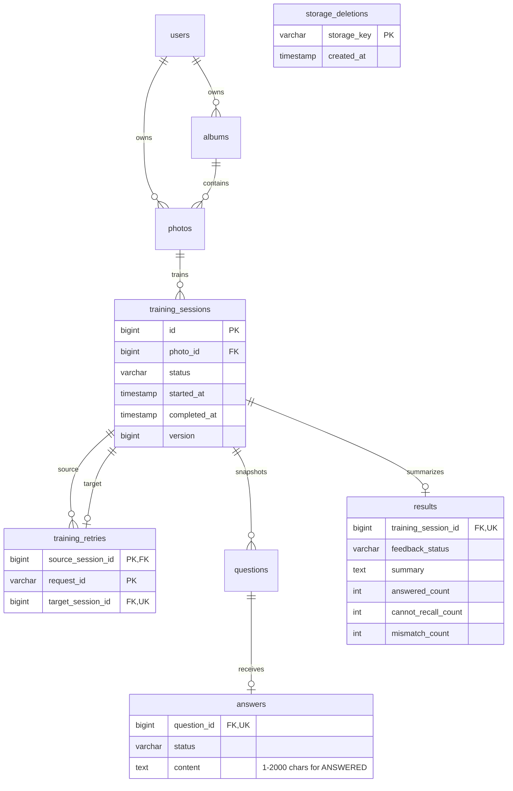

# 2.4 답변 제출 · 2.5 기록 저장 · 2.6 결과 조회

기준 브랜치: `backend-dongmin`. 작업 브랜치: `codex/answers-history-results`.

## 로컬 실행

프로젝트 루트에서 PowerShell로 `./Start-Local.ps1`을 실행합니다. JDK 17, Node.js 20.9 이상이 필요합니다. 최초 실행은 Gradle/npm 의존성을 다운로드합니다.

- 화면: http://localhost:5173/#/login
- API: http://127.0.0.1:18080
- 체험 계정: `demo@example.com` / `DemoPass123!`
- 로그인 → 마이페이지 → 훈련 상세 → 답변 작성·훈련 열기
- 최초 체험 질문: http://localhost:5173/#/training/1 (새 로컬 DB 기준)
- 종료: `./Stop-Local.ps1`. 재실행은 `./Start-Local.ps1 -SkipBuild`.

`local` 프로필은 루프백 주소에만 바인딩합니다. `backend/local-data/memory.mv.db`에 DB, `backend/uploads/`에 이미지를 보존합니다. 해당 폴더와 실행 로그는 Git에서 제외합니다. 체험 사진은 테스트용 그림이고 질문은 고정 문구입니다. 재시작 시 기존 계정과 답변을 초기화하지 않습니다.

로컬 H2 URL에 `WRITE_DELAY=0`을 지정해 커밋 후 로그 쓰기 지연을 끕니다. 기본 지연 설정에서는 저장 직후 프로세스를 강제 종료할 때 마지막 기록이 사라지는 문제가 재현되었습니다. [H2 공식 설정 설명](https://h2database.com/html/commands.html#set_write_delay)을 참고하세요. 이는 프로세스 재시작 검증이며 하드웨어 전원 장애까지 보장하는 시험은 아닙니다.

기본 배포 프로필은 기존 MySQL/R2 설정을 유지합니다. 실제 사진 AI 분석·새 AI 질문 생성은 기존 기능이므로 Gemini/Kakao 설정이 별도로 필요합니다. 회상 답변 저장·발췌 요약·같은 질문 재훈련은 AI 키가 필요 없습니다. 로컬 공개 JWT 키와 체험 계정은 배포에 사용하지 않습니다.

## API

모든 요청은 로그인 Bearer 토큰을 사용합니다. 본문의 사용자 ID는 받지 않습니다.

| 요청 | 내용 |
|---|---|
| `POST /api/users/me/training-sessions/{id}/answers` | 모든 질문의 주관식/선택 상태를 한 번에 저장하고 완료 |
| `GET /api/users/me/training-sessions/{id}` | 사진 ID·앨범 ID·파일명, 질문과 답변, 문항 수, 시각, 요약/생성 상태 |
| `GET /api/users/me/training-sessions?page=0&size=6&photoId=1` | 시작 시각 DESC, ID DESC. photoId 생략 시 전체 이력 |
| `POST /api/users/me/training-sessions/{id}/feedback` | 저장된 답변으로 요약 생성/재시도. 이미 완료된 요약은 유지 |
| `POST /api/users/me/training-sessions/{id}/retrain` | `{ "requestId": "UUID" }`. 같은 사진과 질문으로 새 세션 생성 |

답변 예:

```json
{"answers":[
  {"questionId":101,"status":"ANSWERED","content":"가족과 공원을 걸었습니다."},
  {"questionId":102,"status":"CANNOT_RECALL","content":null},
  {"questionId":103,"status":"QUESTION_MISMATCH","content":null}
]}
```

`ANSWERED`는 본문 1~2000자, 나머지는 본문 없음. 전체 질문을 빠짐없이 제출해야 합니다. 질문 ID 중복·다른 세션 질문·다른 사용자 세션·빈 본문을 거부합니다. 제출 전 미응답은 답변 행 없음으로 표현합니다. 의도적인 건너뛰기는 명시적 상태가 있는 답변 행입니다.

행 잠금으로 동시 제출을 순서대로 처리하며, DB UNIQUE(question_id)와 UNIQUE(training_session_id)가 중복을 방어합니다. 같은 완료 답변의 재시도는 같은 기록을 반환하고, 다른 내용은 409입니다. UI는 제출 중 입력을 잠그고 실패하면 입력을 유지합니다. 임시 입력은 브라우저 메모리에 있으므로 페이지를 떠나거나 새로고침하면 사라질 수 있습니다.

재훈련 requestId는 실패 후 재시도에도 유지하며 `training_retries`의 PRIMARY KEY(source_session_id,request_id)로 중복 세션 생성을 막습니다. 새로운 의도적 재훈련은 새로운 UUID를 사용합니다. 기존 AI 질문 생성 API의 요청 계약은 이번 변경 범위에 포함하지 않습니다.

## ERD와 상태



세션: `CREATED → GENERATING_QUESTIONS → IN_PROGRESS → COMPLETED` 또는 질문 생성 실패. 새 재훈련은 질문을 복사해 `IN_PROGRESS`로 시작합니다. 시작/완료 시각은 UTC로 저장하고 화면에서 현지 시각으로 표시합니다.

V10은 V8의 세션 자기 참조 정보를 요청 테이블로 옮깁니다. 이전 nullable 컬럼은 체크섬/스키마 호환성을 위해 남기지만 값은 비우고 신규 쓰기에 사용하지 않습니다. 재훈련을 여러 번 이어가도 사진 삭제가 자기 참조 FK의 재귀 깊이에 의존하지 않습니다.

답변과 집계/완료는 한 트랜잭션입니다. 결과는 `PENDING`으로 저장한 뒤 별도 요청에서 `COMPLETED` 또는 `FAILED`가 됩니다. 생성 중 서버가 종료되면 해당 트랜잭션만 롤백되고 답변은 남습니다. 다시 결과 화면을 열어 생성·재시도할 수 있습니다. PROCESSING은 향후 비동기 생성기를 위한 기존 상태이며 현재 발췌 생성기는 장기 처리 상태를 남기지 않습니다.

요약은 사용자 문장을 인용하는 결정적 발췌 방식입니다. 사진의 장면이나 감정 등을 새로 추측하지 않고, 기억력 향상/저하 또는 의료적 판정을 생성하지 않습니다. 실제 질문별 답변은 요약 길이와 관계없이 보존됩니다.

사진/앨범 삭제 시 해당 사진을 기준으로 한 모든 훈련·질문·답변·결과를 함께 지웁니다. 다른 사진이 앨범 질문의 근거 스냅샷에 등장하는 경우 그 스냅샷은 해당 훈련의 기준 사진을 삭제할 때까지 남습니다. 파일은 커밋 이후 삭제 큐를 통해 제거합니다. ‘퀴즈 초기화’도 별도 영구 삭제 동작이며 재훈련과 구분합니다.

## 검증

```powershell
cd backend
./gradlew.bat test
cd ../frontend
npm run build
npx playwright test --config playwright.recall.config.js
cd ..
./Verify-Restart.ps1
```

브라우저 테스트는 `Start-Local.ps1`로 실행한 로컬 서버와 설치된 Edge를 사용합니다. 테스트용 계정에 훈련 기록을 추가하며 실제 계정에 연결하지 않습니다. `Verify-Restart.ps1`은 저장된 체험 결과가 있는 상태에서 로컬 프로세스를 종료/재실행하고 결과 JSON 및 재훈련 요청 ID 재사용을 비교합니다.

통합 테스트는 H2에서 Flyway 전체 적용 후 소유권·빈 값·길이·누락·중복·동시 제출·저장 롤백·요약 실패·재훈련·삭제를 검증합니다. MySQL/R2 실서비스 연동은 실제 설정으로 별도 확인해야 합니다. 기존 V7은 `test@1234.com` 계정의 과거 퀴즈를 삭제하는 팀 마이그레이션이므로 기존 DB 반영 시 적용 이력을 확인해야 합니다. 기존 마이그레이션 파일의 체크섬은 바꾸지 않았습니다.
